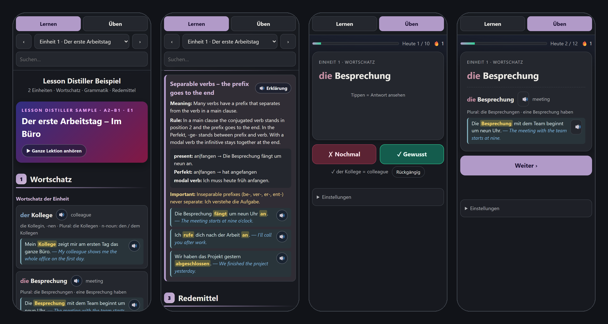

# German Language Distiller

**Turn your German course material into something you can actually study on the go.**

German Language Distiller is an [Agent Skill](https://agentskills.io): a folder with instructions and Python scripts that an AI assistant follows. It works with Claude Code, OpenAI Codex, GitHub Copilot and other assistants that read the open Agent Skills format.

You give it a lesson you're studying: pages from a course book you own, your teacher's lecture slides, a handout, or your own notes. It gives back:

1. **A compact study sheet per lesson**, with only what's worth remembering, in four sections:
   - **Wortschatz**: words with article, plural and Perfekt, each with one natural, memorable example sentence and its translation.
   - **Grammatik**: every rule the lesson teaches, with meaning, rule, pattern and examples, plus a contrast where learners usually slip.
   - **Redemittel**: reusable phrases for e-mails, opinions, requests and small talk, each with a use cue and an example.
   - **Geschichte**: a short, catchy story that reuses most of the lesson's words, grammar and phrases, so you meet them again in context. The lesson's words are underlined, and each paragraph's translation is one tap away.
2. **One offline study app for the whole course**, a single HTML file that runs on your phone:
   - **Lernen:** every sheet and story, with 🔊 neural audio on every German word, example, phrase and story sentence. A 🔊 tap **repeats the sentence until you tap again**, so it can sink in. "🎧 Anhören" plays the whole lesson, **only the examples**, or the story, each sentence 1–5 times, once or endlessly, while the app follows along on screen. Pause, go back or skip ahead at any time, and pick up where you stopped. Listening keeps going with the screen off, with ⏯ ⏮ ⏭ on the lock screen and your headphones.
   - **Üben:** flashcards with spaced repetition and one tap per card. Tap ✓ when you know it, and the next card appears; tap ✗ when you don't, and the answer opens. Practise in short rounds of 10, with a daily goal and a streak.
   - **Spielen:** five quick games per lesson for days without motivation: **Hör-Bingo** (hear a sentence, find a word of your card in it), **Wortpaare** (match words and meanings against the clock), **Satzbau** (put the words in order), **Der · Die · Das** (60-second article sprint) and **Was sagt man?** (pick the phrase that fits the situation). Every round has one clear right answer, and a mistake stays on screen until you have read it.
3. **MP3 listening episodes**, one per lesson (15–30 minutes): German, a pause to repeat, English, and the story at the end. An optional examples-only set repeats every example sentence for the commute.



*Screens from the included [sample course](examples/sample-course/), which uses original example content.*

## Why it works

Rereading a lesson feels productive but fades fast. German Language Distiller reads the *whole* lesson: word lists, picture vocabulary, grammar boxes, model texts, exercises, and a slide's speaker notes. It keeps only what materially improves your German, and writes its own examples: sentences an adult would really say, specific enough to picture, never silly filler. Every card is checked for accuracy before it reaches you, so a lesson becomes a single page you can absorb, followed by a story that brings it all back to life.

The app then does the remembering for you. Spaced repetition decides what comes back and when. Listening with pauses and repeats trains your ear and pronunciation. The Redemittel cards ask the way an exam does: the situation is shown in English and you produce the German phrase. And on a tired evening, a two-minute game still moves you forward.

**German always sounds German.** Every German word is spoken by a German voice, even inside an English explanation ("use «als» for the past"). English is spoken by an English voice. One bilingual voice would read short German words with English pronunciation.

## Install

Pick the line for your assistant. Every option installs the same folder, [`skills/german-language-distiller/`](skills/german-language-distiller/).

**Claude Code**

```text
/plugin marketplace add omaratif1995/german-language-distiller
/plugin install german-language-distiller@german-language-distiller
```

Or copy the folder to `~/.claude/skills/` (all projects) or `.claude/skills/` (one project).

**OpenAI Codex, GitHub Copilot and other Agent Skills clients**

Copy the folder to `~/.agents/skills/` (all projects) or `.agents/skills/` (one project):

```bash
git clone https://github.com/omaratif1995/german-language-distiller
mkdir -p ~/.agents/skills && cp -r german-language-distiller/skills/german-language-distiller ~/.agents/skills/
```

On Windows, run `Copy-Item -Recurse german-language-distiller\skills\german-language-distiller $HOME\.agents\skills\`. GitHub Copilot also reads `~/.copilot/skills/` and `.github/skills/`. If your assistant doesn't find the skill, check its documentation for its skills folder, then restart it.

**Requirements:** Python 3.10 or newer. Audio also needs `pip install edge-tts pyspellchecker imageio-ffmpeg`.

## Use

Just ask, for example:

- *"Distill Lektion 3 of `Kursbuch.pdf` and the matching Arbeitsbuch pages."*
- *"Distill the slides from today's German class, `Lecture_05.pptx`."*
- *"Do lessons 1–6 the same way and build the study app with audio."*
- *"Make MP3 listening episodes for all finished lessons."*

The assistant inspects the pages or slides, writes the lesson data, validates it with the bundled scripts and renders the sheet. Everything lands in a `<source> - Digested` folder next to your material, and earlier versions are kept.

The scripts also run on their own. That's useful for rebuilding the app after you edit a lesson file:

```bash
python skills/german-language-distiller/scripts/study_pack.py render --inventory … --lesson … --review … --source … --output L01_Studysheet_v2.html
python skills/german-language-distiller/scripts/course_audio.py plan --course _work/course.json
python skills/german-language-distiller/scripts/course_audio.py episodes --course _work/course.json --confirm-external-tts --kind examples --repeat 2
python skills/german-language-distiller/scripts/build_course_app.py --course _work/course.json --output Course_App_v2.html
```

The skill's [references](skills/german-language-distiller/references/) document the data format, the audio rules and the app.

## Privacy and copyright

- **Your own material only.** Use the skill with material you own or are allowed to use, such as your books or your teacher's handouts. Don't publish a book's or a teacher's content.
- **Notes in your own words.** The sheets never name their source (no book title, publisher, ISBN or characters), and their titles, examples and stories are newly written. The source is recorded only in the internal `_work` files. The skill never publishes anything for you; if you want to share your notes, check the rules that apply to you first, and remember that the audio comes from a third-party voice service with its own terms.
- **Everything stays local**, except audio. Speech is generated with Microsoft's neural voices through `edge-tts`, which sends the selected sentences to that service. The skill asks before it does that, and you can always build without audio (`--no-audio`).
- **Progress stays on your device.** The app has no account and no tracking. Your progress lives in your phone's browser, and the backup button moves it between devices.

## Good to know

- **For German learners:** the sheets, the voices and the app are built for German, tested with B1 material.
- **iPhone:** the Files and messenger previews don't run the app's buttons. Open the file in a browser that runs local files, or host it privately. The MP3s play everywhere.
- **Screen off:** the app joins a listening session into one continuous audio track with lock-screen and headphone buttons (⏯ ⏮ ⏭), so playback keeps going when the screen turns off. The MP3 episodes also work in any music player.
- **A study aid, not a guarantee.** A digest replaces rereading, not practice. Listening to real-speed German, speaking with a partner and timed exam practice are still on you.

## Repository layout

```text
skills/german-language-distiller/SKILL.md         the skill: workflow and quality rules
skills/german-language-distiller/references/      authoring rules, data contract, audio and app design
skills/german-language-distiller/scripts/         validator, renderer, speech, audio and app builders, tests
examples/sample-course/                    two original sample lessons, their sheets and the app
.claude-plugin/                            Claude Code plugin and marketplace entry
```

Run the tests with `python -m unittest` inside `scripts/`. The speech tests need `pyspellchecker` and are skipped without it.

## License

[MIT](LICENSE)
